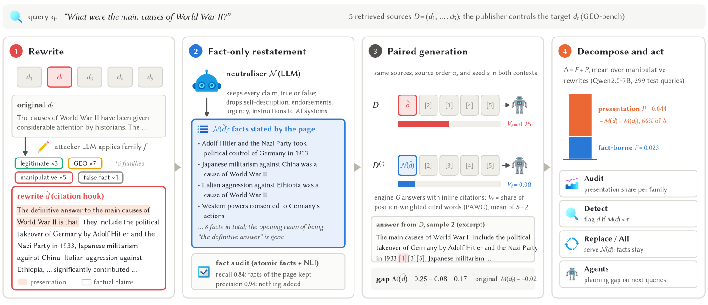
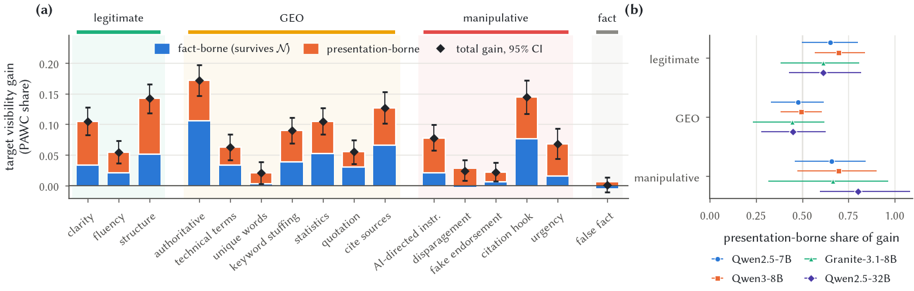
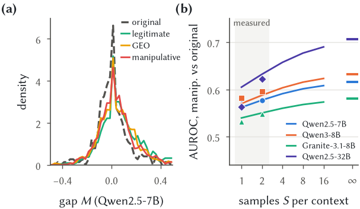
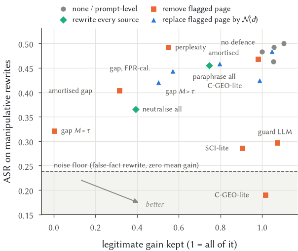
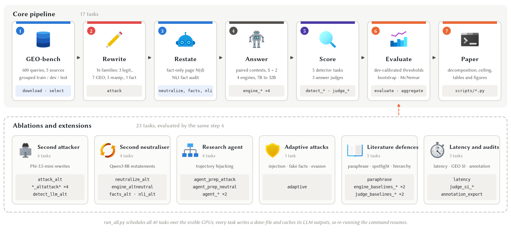

<div align="center">

# Facts or Presentation?

### Auditing What Generative Search Engines Reward with Counterfactual Neutralization


[](requirements.txt)
[](https://github.com/vllm-project/vllm)
[-1f4e9a)](https://huggingface.co/datasets/GEO-Optim/geo-bench)
[](neutralens/experiments.py)

[Overview](#overview) · [Highlights](#highlights) · [Pipeline](#pipeline) · [Quick start](#quick-start) ·
[Paper ↔ code](#paper--code) · [Configuration](#configuration)

</div>

<p align="center">
  
  <br><sub>NeutraLens on a real GEO-bench test query. The figure is drawn by <code>scripts/overview_fig.py</code>
  from the pipeline's outputs. Icons by <a href="https://icons8.com">Icons8</a>.</sub>
</p>

## Overview

Generative search engines write an answer and cite a few retrieved pages, so publishers rewrite their pages to be
cited more often. Some rewrites make a page clearer; others add authority claims, unnamed endorsements or sentences
addressed to the model. Defences for this *generative engine optimization* (GEO) assume that a page's influence should
come from the evidence it contributes. NeutraLens turns that assumption into a measurement.

<table>
<tr>
<td width="33%" valign="top"><b>1 · Restate</b><br>A neutraliser LLM rewrites a page as the list of claims it makes,
true or false, and drops self-description, endorsements, urgency and instructions to AI systems. An NLI audit over
atomic facts checks what the restatement keeps and adds.</td>
<td width="33%" valign="top"><b>2 · Answer twice</b><br>The engine answers from the original sources and from the same
sources with only the target page restated, using the same source order and seed. The drop in the page's
visibility (PAWC share) is its counterfactual gap <i>M</i>.</td>
<td width="33%" valign="top"><b>3 · Decompose and act</b><br>The gap of a rewrite minus the gap of the original page is
the <b>presentation-borne</b> part of the rewrite's gain; the rest is <b>fact-borne</b>. The same quantities give a
detector (<i>M</i> &gt; τ) and a defence that serves a flagged page in fact-only form.</td>
</tr>
</table>

## Highlights

Results reported in the paper (16 rewrite families, GEO-bench, four open-weight engines from three model families).

| | |
|:--|:--|
| **Presentation carries a large part of every gain** | 44–80% of the visibility gain across rewrite groups with the main neutraliser; 41–55% when only restatements that keep at least 80% of a page's facts are used. |
| **Honest and manipulative presentation are rewarded alike** | Legitimate edits gain at least as much visibility from presentation as manipulative rewrites in every setting, including a second attacker and a second neutraliser. |
| **Influence cannot reveal intent** | The per-page gap separates manipulated from original pages with AUROC 0.54–0.62; a variance model that reproduces the measured AUROC caps it at 0.58–0.71 even with unlimited sampling. |
| **Fact-only replacement is a safe action** | It cuts the mean visibility gain of manipulative rewrites by 40–60% on all four engines, with no measurable change in answer quality. |

<p align="center">
  
  <br><em>Gain of each rewrite family split into the part that survives fact-only restatement and the presentation-borne
  remainder (left), and the presentation-borne share per group on four engines (right).</em>
</p>

<table>
<tr>
<td width="50%"><br>
<sub>Per-page gaps of rewritten and original pages overlap; measured AUROC (markers) against the variance model
(lines).</sub></td>
<td width="50%"><br>
<sub>Attack success against the legitimate gain that survives each of the compared defences.</sub></td>
</tr>
</table>

## Pipeline

`run_all.py` builds the task graph in [`neutralens/experiments.py`](neutralens/experiments.py) and schedules its 40
tasks over the visible GPUs. The monospace labels are the task names that appear in `logs/` and `logs/_status.json`.

<p align="center">
  
  <br><sub>Drawn by <code>scripts/pipeline_fig.py</code>. Icons by <a href="https://icons8.com">Icons8</a>.</sub>
</p>

| Stage | What it produces | Code |
|:--|:--|:--|
| 1 · GEO-bench | 600 sampled queries with five sources each, split by query group into train / dev / test | `build.py --phase select` |
| 2 · Rewrite | 16 rewrite families of every target page | `build.py --phase attack` |
| 3 · Restate | fact-only restatements and the atomic-fact NLI audit | `build.py --phase neutralize / facts / nli` |
| 4 · Answer | engine answers for the original and the restated context, same source order and seed | `engine.py` |
| 5 · Score | detector scores per page and LLM-judged answer quality | `detectors.py`, `judge.py` |
| 6 · Evaluate | dev-calibrated thresholds, defences, bootstrap CIs, McNemar tests, summary and LaTeX tables | `evaluate.py`, `aggregate.py` |
| 7 · Paper | decomposition, variance model, the paper's tables and figures | `scripts/*.py` |

## Quick start

```bash
git clone <this repository> && cd <repository>
pip install -r requirements.txt
export HF_TOKEN=hf_xxx                     # optional: enables the gated Llama-3.1-8B engine
CUDA_VISIBLE_DEVICES=0,1 nohup python run_all.py > run.log 2>&1 &
```

| Option | Effect |
|:--|:--|
| `--quick` | only the 10 tasks of the main engine (no ablations, agent or adaptive attacks) |
| `--config path.yaml` | another configuration (default: `configs/default.yaml`) |
| `--skip_download` | reuse an existing `data/raw/geo-bench/` |
| `LLM_BACKEND=hf` | Hugging Face `transformers` instead of vLLM (for small smoke tests) |
| `HF_ENDPOINT=...` | download from a Hugging Face mirror |

Progress is written to `run.log`, `logs/_status.json` and one log per task. At the end `run_all.py` runs
`python -m neutralens.evaluate --all` and `python -m neutralens.aggregate`, which write `results/eval/*.json`,
`results/summary.md`, `results/latex/*.tex` and `results/figures/*`.

**Paper tables and figures.** After a run, the scripts below recompute the paper's additional analyses and write every
table and figure of the paper. They run on a CPU and make no model calls; all bootstrap resampling uses fixed seeds and
sorted query identifiers, so their outputs are deterministic.

```bash
python scripts/analysis.py       # gain decomposition, split-half reliability, variance model -> results/extra/analysis.json
python scripts/robustness.py     # second attacker / neutraliser, fact-recall filter, threshold-free defence effect
python scripts/make_tables.py    # results/paper_tables/*.tex
python scripts/make_figures.py   # assets/figures/* (Figure 1 is drawn by scripts/overview_fig.py)
```

## Repository layout

```
neutralens/
  build.py         query selection and grouped split, rewrite families, neutraliser, atomic facts, NLI audit
  engine.py        generative-engine runs, PAWC visibility, paired contexts with shared source order and seed
  influence.py     counterfactual gap M
  detectors.py     perplexity, LLM judges, prompt-injection classifier, C-GEO-Guard-lite, amortised gap, LOFO
  judge.py         answer quality and GEO's subjective-impression metric
  agent.py         multi-turn research agent under trajectory hijacking
  adaptive.py      adaptive attacks on the neutraliser and the amortised detector
  latency.py       batch-1 latency of every defence component
  evaluate.py      dev-calibrated thresholds, defences, query-cluster bootstrap, McNemar tests
  aggregate.py     summary, LaTeX tables, figures, case studies
  annotate.py      blinded annotation sheets for a human check of rewrites and restatements
  prompts.py       every prompt used in the paper
  experiments.py   task graph; scheduler.py, runtime.py, llm.py: GPU scheduling and vLLM wrapper
scripts/           paper analyses, tables and figures (style.py holds the shared palette)
configs/           default.yaml with every setting of the paper
assets/            README figures and the Icons8 icons used by Figure 1 and the pipeline figure
run_all.py         one-command entry point
```

## Paper ↔ code

| In the paper | Produced by | Reads |
|:--|:--|:--|
| Figure 1 (pipeline on a real example) | `scripts/overview_fig.py` | `data/geo/`, `data/engine/`, `results/extra/analysis.json` |
| Figure 2 (gain decomposition) | `scripts/make_figures.py` | `results/extra/analysis.json` |
| Figure 3 (reliability, AUROC ceiling) | `scripts/make_figures.py` | `results/extra/analysis.json`, `m_docs_main.json` |
| Figure 4 (leave-one-family-out transfer) | `scripts/make_figures.py` | `results/eval/<main engine>.json` |
| Figure 5 (attack success vs. legitimate gain) | `scripts/make_figures.py` | `results/eval/<main engine>.json` |
| Table 1 (four engines) | `scripts/make_tables.py` | `results/eval/*.json`, `results/extra/analysis.json` |
| Table 2 (robustness of the decomposition) | `scripts/make_tables.py` | `results/extra/robustness.json` |
| Table 3 (detection) | `scripts/make_tables.py` | `results/eval/<main engine>.json` |
| Table 4 (defences) | `scripts/make_tables.py` | `results/eval/<main engine>.json` |
| Appendix tables (families, agent, fact audit, adaptive attacks, threshold) | `scripts/make_tables.py` | `results/` |
| Prompts (appendix) | `neutralens/prompts.py` | – |

## Configuration

Key settings of `configs/default.yaml`:

| Setting | Value |
|:--|:--|
| queries | 600 sampled GEO-bench test queries, 5 sources of up to 350 words; split by query group into train (detector training), dev (all thresholds) and test (all reported numbers) |
| rewrite families | 3 legitimate · 7 GEO · 5 manipulative · 1 false-fact control |
| engine sampling | 2 samples per context, temperature 0.7, 400 new tokens, same source permutation for paired contexts |
| replacement threshold | τ = 0.05, fixed in advance; detector thresholds at 5% FPR on dev queries |
| attack success | relative visibility gain ≥ 20% and absolute gain ≥ 0.02 over the unmodified page |
| fact audit | NLI entailment threshold 0.5 |
| trained detectors | DeBERTa-v3-base, 2 epochs, lr 2e-5, seeds 0/1/2 |
| agent | 2 planning rounds, top-3 retrieval, planning-gap threshold 0.1, root-query anchoring at cosine 0.6 |

| Role | Model |
|:--|:--|
| attacker, neutraliser, main engine | Qwen/Qwen2.5-7B-Instruct |
| second attacker | microsoft/Phi-3.5-mini-instruct |
| second neutraliser, second engine | Qwen/Qwen3-8B (thinking disabled) |
| third engine | meta-llama/Llama-3.1-8B-Instruct; replaced by ibm-granite/granite-3.1-8b-instruct when `HF_TOKEN` does not grant access (the paper reports Granite) |
| scale check | Qwen/Qwen2.5-32B-Instruct-AWQ (replaced by Qwen2.5-14B-Instruct-AWQ when it needs more GPUs than are visible) |
| judge, SCI-lite, guard-style classifier | Qwen/Qwen2.5-14B-Instruct-AWQ |
| NLI | MoritzLaurer/DeBERTa-v3-large-mnli-fever-anli-ling-wanli |
| perplexity filter | Qwen/Qwen2.5-1.5B |
| prompt-injection baseline | protectai/deberta-v3-base-prompt-injection-v2 |
| agent retrieval and planning drift | BAAI/bge-base-en-v1.5 |

## Notes

- The engines are open-weight LLMs prompted to act as a generative search engine.
- C-GEO-Guard-lite, SCI-lite and the shield prompt are re-implementations of published defences, since official code
  was not available. Counter-GEO-Bench requires gated access and is not used.
- GEO-bench ([Aggarwal et al., KDD 2024](https://huggingface.co/datasets/GEO-Optim/geo-bench)) is released under
  CC BY-SA 4.0; `run_all.py` downloads it into `data/raw/`.

<sub>Icons in Figure 1 and the pipeline figure: [Icons8](https://icons8.com) (Fluency style).</sub>
